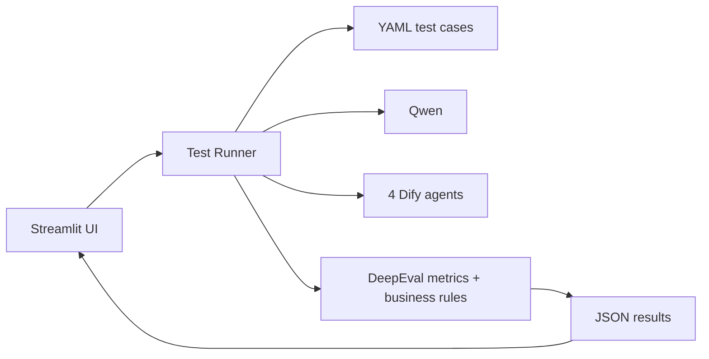
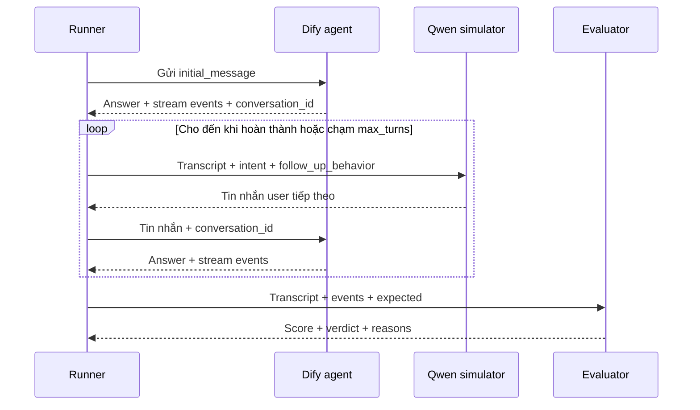

# Kế hoạch MVP tool healthcheck/evaluation cho 4 Dify agent

## 1. Mục tiêu

Làm một tool nội bộ đơn giản để kiểm tra 4 agent trên Dify:

- `leave`: tạo và quản lý đơn nghỉ.
- `late`: tạo và quản lý đơn đi trễ.
- `helpdesk`: tạo, xem và xóa ticket IT.
- `bookroom`: tạo, xem, sửa và hủy lịch.

Tool giải quyết ba việc:

1. Cho biết agent còn gọi được hay không, thời gian phản hồi và lỗi gặp phải.
2. Chạy hội thoại test nhiều lượt để kiểm tra agent có xử lý đúng nghiệp vụ không.
3. Dùng Qwen để sinh thêm kịch bản, mô phỏng user và làm evaluation model cho các metric có sẵn của DeepEval.

MVP chạy thủ công trên máy nội bộ. Chưa xây hệ thống scheduling, queue, database server hay cảnh báo tự động.

## 2. Phạm vi MVP

### Có trong MVP

- Một giao diện Streamlit.
- Cấu hình được 4 Dify agent.
- Nhập hoặc chọn test case hội thoại multi-turn.
- Qwen sinh thêm case từ case mẫu.
- Qwen đóng vai user ở các lượt tiếp theo.
- Gọi Dify bằng streaming API và giữ `conversation_id`.
- Lưu transcript, thời gian phản hồi và các event thu được từ Dify.
- Chấm bằng các metric multi-turn có sẵn của DeepEval, bổ sung một số rule nghiệp vụ đặc thù.
- Xem kết quả theo từng case và xuất JSON.

MVP chỉ có một loại evaluation case: `ConversationalTestCase` multi-turn. Không hỗ trợ `LLMTestCase`/single-turn và không có trường `mode` để chuyển qua lại giữa hai loại.

### Chưa làm trong MVP

- Không có React/FastAPI riêng.
- Không có Redis, Celery hay worker queue.
- Không có PostgreSQL, S3 hoặc MinIO.
- Không gửi Slack, email hoặc Teams.
- Không có RBAC và quản lý nhiều tổ chức.
- Không tự động chạy theo cron hoặc CI/CD.
- Không tự động thay đổi hay deploy Dify agent.
- Không chạy tải lớn hoặc nhiều máy.

Nếu MVP chứng minh được cách sinh case, mô phỏng hội thoại và chấm kết quả là hữu ích thì mới bổ sung các phần vận hành trên.

## 3. Phần tham khảo từ code hiện có

Code trong `IT_RAG_LARGE_FULL (1)/IT_RAG_LARGE_FULL` đã có các phần có thể tái sử dụng:

- `create_llm.py`: adapter `QwenLLM` theo chuẩn OpenAI/DeepEval.
- `dify_helper.py`: cách gọi `/chat-messages`, đọc streaming event, retry và giữ `conversation_id`.
- `eval.py`: cách dùng `ConversationSimulator` và chạy metric.
- `generate_synthetic_dataset.py`: cách dùng Qwen/DeepEval để sinh golden.
- `eval-results`: cách lưu kết quả đánh giá thành JSON.

MVP không bê nguyên pipeline RAG hiện tại vì 4 agent là agent nghiệp vụ. Metric RAG như contextual precision hoặc retrieval recall không đủ để bắt các lỗi như:

- Gọi sai tool.
- Tạo đơn khi user muốn sửa.
- Tạo/xóa trước khi user xác nhận.
- Nói “đã tạo” khi tool chưa thành công.
- Bỏ sót một ngày trong yêu cầu nhiều ngày.
- Làm lộ ID, token hoặc mã nội bộ.

Vì vậy DeepEval là framework chấm chính của MVP. Tool chỉ bổ sung một lớp rule nhỏ cho các luật nghiệp vụ quá cụ thể mà metric tổng quát không thể biết, ví dụ bắt buộc preview trước create hoặc phải in nguyên văn `messageToUser`.

## 4. Kiến trúc MVP



Chỉ có một process Python. Khi người dùng bấm chạy, Streamlit gọi runner; runner lần lượt hoặc song song nhẹ các case, sau đó ghi kết quả xuống file JSON.

## 5. Cấu trúc file đề xuất

```text
TicketAgents/
├── system_prompts/
│   ├── leave.txt
│   ├── late.txt
│   ├── helpdesk.txt
│   └── bookroom.txt
├── docs/
│   └── healthcheck-eval-plan.md
├── eval_tool/
│   ├── app.py                 # Giao diện Streamlit
│   ├── config.py              # Đọc .env và agents.yaml
│   ├── models.py              # Pydantic schema
│   ├── dify_client.py         # Gọi Dify, thu stream, trace và timing
│   ├── qwen_client.py         # Client Qwen dùng chung
│   ├── case_generator.py      # Sinh case từ prompt + seed case
│   ├── user_simulator.py      # Sinh câu trả lời user từ lượt thứ hai
│   ├── evaluator.py           # Tạo DeepEval test case, chạy metric và rule
│   ├── runner.py              # Điều phối một case hoặc một nhóm case
│   └── report.py              # Tổng hợp và lưu JSON
├── configs/
│   └── agents.yaml            # Cấu hình 4 agent, không chứa secret thật
├── data/
│   ├── seeds/
│   │   ├── leave.yaml
│   │   ├── late.yaml
│   │   ├── helpdesk.yaml
│   │   └── bookroom.yaml
│   ├── generated/             # Case do Qwen sinh
│   └── runs/                  # Kết quả từng lần chạy
├── prompts/
│   ├── generate_case.md
│   └── simulate_user.md
├── .env.example
├── requirements.txt
└── run.py                     # Chạy UI hoặc chạy test từ command line
```

Giải thích các file chính:

- `app.py`: chỉ hiển thị form, gọi runner và render kết quả; không chứa logic chấm.
- `runner.py`: quản lý vòng lặp hội thoại, giới hạn số lượt và gom trace.
- `dify_client.py`: là phiên bản mở rộng của `dify_helper.py`, hỗ trợ chọn API key theo agent; đóng timestamp cho từng stream event và chuẩn hóa tool trace.
- `user_simulator.py`: nhận transcript và user plan để Qwen tạo tin nhắn tiếp theo.
- `evaluator.py`: chuyển transcript/trace sang `ConversationalTestCase`, chạy các metric DeepEval bằng `QwenLLM`, sau đó chạy thêm các rule nghiệp vụ đặc thù.
- `data/runs`: mỗi run là một file JSON để MVP không cần database.

## 6. Cấu hình 4 agent

`configs/agents.yaml` chỉ lưu tên biến môi trường chứa API key:

```yaml
agents:
  leave:
    display_name: Leave Agent
    api_key_env: DIFY_LEAVE_API_KEY
    prompt_file: system_prompts/leave.txt
    default_inputs:
      emp_id: TEST001
      emp_name: Nhân viên Test

  late:
    display_name: Late Agent
    api_key_env: DIFY_LATE_API_KEY
    prompt_file: system_prompts/late.txt
    default_inputs:
      emp_id: TEST001
      emp_name: Nhân viên Test

  helpdesk:
    display_name: Helpdesk Agent
    api_key_env: DIFY_HELPDESK_API_KEY
    prompt_file: system_prompts/helpdesk.txt
    default_inputs:
      emp_id: TEST001
      emp_name: Nhân viên Test

  bookroom:
    display_name: Bookroom Agent
    api_key_env: DIFY_BOOKROOM_API_KEY
    prompt_file: system_prompts/bookroom.txt
    default_inputs:
      emp_id: TEST001
      emp_name: Nhân viên Test
```

`DIFY_API_URL`, bốn API key và cấu hình Qwen nằm trong `.env`. File kết quả không được ghi API key.

## 7. Cấu trúc một test case

Mỗi test case luôn là một tình huống multi-turn, nhưng không viết sẵn toàn bộ hội thoại. Case cố định tin nhắn đầu tiên; Qwen simulator tạo các lượt user tiếp theo. Seed case và generated case dùng chung đúng một schema này.

```yaml
id: leave-multi-date-001
agent: leave
name: Tạo đơn cho ba ngày riêng biệt
tags: [multi-turn, multi-item]

user_plan:
  initial_message: "Xin nghỉ ngày 20, 21 và 23 tháng 10"
  intent: >
    Muốn tạo ba đơn nghỉ phép riêng cho ngày 20, 21 và 23/10/2026.
    Lý do là việc gia đình. Chỉ đồng ý tạo khi đã thấy đủ ba thẻ preview.
  follow_up_behavior: >
    Nếu agent hỏi lý do thì trả lời "Việc gia đình". Nếu agent hiển thị đúng
    đủ ba thẻ preview thì xác nhận tạo. Nếu agent bỏ sót hoặc gộp ngày thì
    nhắc đây là ba ngày riêng biệt và chưa xác nhận.

expected:
  outcome: Agent tạo đủ ba đơn riêng sau bước preview và xác nhận.
  must:
    - Không dùng câu yêu cầu làm lý do.
    - Preview đủ ba ngày trước khi tạo.
    - Báo kết quả của từng đơn.
  must_not:
    - Gộp ba ngày thành một khoảng.
    - Nói đã tạo trước khi tool thành công.
    - Hiển thị submitRef hoặc ID nội bộ.

limits:
  min_user_turns: 2
  max_turns: 6
  timeout_seconds: 180
```

Ý nghĩa:

- `initial_message`: câu đầu tiên gửi nguyên văn cho Dify.
- `intent`: mục tiêu thật của user và những thông tin user đang biết.
- `follow_up_behavior`: cách user trả lời trong những lượt sau.
- `expected.outcome`: kết quả nghiệp vụ cần đạt.
- `must` và `must_not`: tiêu chí nghiệp vụ đặc thù để rule checker kiểm tra; phần chất lượng hội thoại dùng metric DeepEval.
- `min_user_turns`: số lượt user tối thiểu để case thực sự kiểm tra khả năng giữ hội thoại.
- `max_turns`: giới hạn tổng số lượt để hội thoại không chạy vô hạn.

Tin nhắn từ lượt thứ hai không được lưu sẵn. Qwen simulator đọc transcript cùng `intent` và `follow_up_behavior` để trả lời tự nhiên theo tình huống thực tế.

## 8. Luồng sinh test case

Người dùng chọn:

- Agent cần sinh test.
- Một hoặc nhiều seed case.
- Số case muốn sinh.
- Nhóm tình huống, ví dụ happy path, thiếu thông tin, lỗi nghiệp vụ hoặc bảo mật.

Tool gửi cho Qwen:

1. System prompt của agent.
2. Các seed case được chọn.
3. Yêu cầu sinh case mới, không sao chép nguyên case mẫu.
4. JSON schema bắt buộc.

Qwen trả về:

- `initial_message`.
- `intent`.
- `follow_up_behavior`.
- `expected.outcome`.
- Danh sách `must` và `must_not`.

Generator phải tạo tình huống có ít nhất một hành vi tiếp nối hợp lý, chẳng hạn agent cần hỏi thông tin còn thiếu, user xác nhận, user sửa một field hoặc phản hồi kết quả trung gian. Case có thể giải quyết hoàn toàn chỉ sau một câu trả lời của agent thì không phù hợp với evaluation set này.

Tool kiểm tra output có đúng schema và đúng agent hay không rồi lưu vào `data/generated/<agent>-<timestamp>.yaml`.

Case do Qwen sinh được lưu thẳng vào `data/generated/` và có thể chạy ngay. Giao diện vẫn cho phép sửa YAML nếu nội dung sinh ra chưa phù hợp; không có trạng thái approve hoặc quy trình review riêng.

## 9. Luồng chạy một test case



Chi tiết runner:

1. Tạo `case_run_id` và bắt đầu timer.
2. Gửi `initial_message` với `conversation_id` rỗng.
3. Lưu answer, conversation ID và mọi stream event lấy được.
4. Khi chưa đủ `min_user_turns`, gọi Qwen simulator để tạo lượt user tiếp theo theo `follow_up_behavior`, trừ khi có lỗi hạ tầng không thể tiếp tục.
5. Sau số lượt tối thiểu, xác định đã kết thúc chưa. Ví dụ: task hoàn thành, agent từ chối hợp lệ, có lỗi không thể tiếp tục hoặc đạt `max_turns`. Nếu chưa kết thúc thì tiếp tục gọi simulator.
6. Gửi lời đó vào cùng conversation.
7. Sau khi dừng, chạy evaluator và ghi một file JSON.

Nếu request Dify bị timeout hoặc lỗi kết nối, runner retry tối đa một số lần cấu hình được. Lỗi nghiệp vụ từ tool không được retry như lỗi mạng.

## 10. Cách chấm trong MVP

MVP dùng các metric có sẵn của DeepEval làm lớp chấm chính. Qwen được truyền vào từng metric qua `QwenLLM`; không cần viết thêm một Qwen judge với bốn dimension riêng.

### 10.1. Chuẩn hóa dữ liệu sang DeepEval

Sau khi hội thoại kết thúc, runner chuyển dữ liệu thành `ConversationalTestCase`:

```python
ConversationalTestCase(
    name=case.id,
    scenario=case.user_plan.intent,
    expected_outcome=case.expected.outcome,
    chatbot_role=agent.chatbot_role,
    turns=[
        Turn(role="user", content="..."),
        Turn(
            role="assistant",
            content="...",
            tools_called=[...],
            retrieval_context=[...],
        ),
    ],
)
```

Mỗi Dify tool event được đổi thành `ToolCall(name, input_parameters, output)`. Retrieval context chỉ gắn vào turn nếu Dify thực sự trả context.

### 10.2. Metric DeepEval dùng cho mọi agent

| Metric | Chấm điều gì trong tool này |
|---|---|
| `TurnRelevancyMetric` | Mỗi câu trả lời có liên quan trực tiếp tới tin nhắn user gần nhất hay không |
| `RoleAdherenceMetric` | Agent có giữ đúng vai trò Leave/Late/Helpdesk/Bookroom và cách hành xử được giao không |
| `KnowledgeRetentionMetric` | Agent có nhớ ngày, lý do, title, lựa chọn và phần user đã sửa qua nhiều lượt không |
| `ConversationCompletenessMetric` | Hội thoại có xử lý đủ các ý định và thông tin user yêu cầu không |
| `GoalAccuracyMetric` | Kết quả cuối cùng có đạt đúng mục tiêu của user không |
| `ToolUseMetric` | Agent có chọn tool phù hợp và truyền argument hợp lý trong toàn hội thoại không |
| `TopicAdherenceMetric` | Agent có ở đúng phạm vi nghiệp vụ của mình không |

Cấu hình cần cung cấp thêm:

- `RoleAdherenceMetric`: `chatbot_role` lấy từ vai trò đầu system prompt.
- `TopicAdherenceMetric`: danh sách topic hợp lệ của từng agent.
- `ToolUseMetric`: danh sách `available_tools` và `tools_called` thu từ Dify trace.
- `GoalAccuracyMetric` và `ConversationCompletenessMetric`: dùng toàn bộ turns; `scenario` và `expected_outcome` vẫn được lưu trong case để mô tả mục tiêu và phục vụ các metric cần đến.

Ngưỡng MVP ban đầu dùng mặc định `0.5` của DeepEval, sau đó điều chỉnh bằng một nhóm case đã được người đánh giá. UI hiển thị riêng score, pass/fail và reason của từng metric; không gộp thành bốn dimension tự định nghĩa.

### 10.3. Metric chỉ bật khi có retrieval context

Các metric sau không chạy mặc định cho mọi case:

| Metric | Khi nào dùng |
|---|---|
| `TurnFaithfulnessMetric` | Assistant đưa ra thông tin dựa trên context/tài liệu Dify lấy về |
| `TurnContextualPrecisionMetric` | Cần đánh giá thứ tự context được retrieve so với expected outcome |
| `TurnContextualRecallMetric` | Cần kiểm tra context có đủ dữ kiện để đạt expected outcome không |
| `TurnContextualRelevancyMetric` | Cần kiểm tra context lấy về có liên quan tới câu hỏi không |

Nếu một case không có `retrieval_context`, các metric này được ghi là `SKIPPED`, không chấm `0`. Với các flow thuần tool như tạo đơn hoặc đặt lịch, chạy contextual metrics sẽ không có ý nghĩa.

### 10.4. Rule nghiệp vụ bổ sung

DeepEval metric là metric tổng quát nên vẫn cần một số kiểm tra deterministic nhỏ:

- Có response, timeout hoặc stream kết thúc bất thường không.
- Có `submitRef`, `confirmToken`, JSON nội bộ, ID hoặc tên tool trong câu trả lời không.
- Agent có nói “đã tạo”, “đã gửi”, “đã xóa” khi trace chưa có success không.
- Có preview trước create, confirm trước create/delete/cancel theo đúng flow không.
- Có gọi đúng thứ tự đặc thù như `recall → edit` hay `list → update/cancel` không.
- Nội dung cần in nguyên văn có khác `reply.message`/`messageToUser` không.
- Yêu cầu nhiều item có bị bỏ sót item không.

Các rule này không thay thế DeepEval; chúng chỉ bắt những điều kiện nhị phân mà metric chung không biết từ system prompt.

Khả năng kiểm tra tool, argument và thứ tự phụ thuộc vào Dify stream có trả tool trace hay không. Nếu không lấy được trace thì `ToolUseMetric` và các rule tool-level phải hiển thị `SKIPPED`, không được suy đoán tool call từ câu trả lời.

### 10.5. Verdict

- `PASS`: tất cả metric bắt buộc đạt threshold và không có rule critical bị fail.
- `FAIL`: ít nhất một metric bắt buộc fail hoặc có rule critical fail.
- `ERROR`: không chạy/chấm được do Dify, Qwen hoặc file cấu hình lỗi.
- `SKIPPED`: metric thiếu dữ liệu đầu vào, ví dụ không có tool trace hoặc retrieval context.

Có thể hiển thị trung bình các metric để so sánh các lần chạy, nhưng verdict không dựa vào một công thức trọng số tự đặt trong MVP.

Lỗi nghiêm trọng gồm:

- Báo thành công khi chưa thực hiện thành công.
- Thực hiện hành động cần xác nhận khi user chưa xác nhận.
- Làm lộ ID/token/prompt/tool input nội bộ.
- Thao tác sai ý định chính, ví dụ user muốn sửa nhưng agent tạo mới.
- Bỏ mất một phần yêu cầu nhiều item mà không báo.

## 11. Nội dung test chính của từng agent

### Leave

- Tạo đơn: lấy đủ thông tin → preview → user xác nhận → create → hỏi gửi duyệt.
- Ngày tương đối phải dùng calendar, không tự tính.
- Nhiều ngày liệt kê phải tạo nhiều đơn.
- Khoảng có nửa ngày không được bỏ ngày ở giữa.
- Sửa phải dùng edit; đơn pending phải recall trước.
- Không tự tính số dư phép hoặc bịa quy định.
- Không lộ `submitRef`, ID, tên tool hoặc mã loại nội bộ.

### Late

- Có ngày, số phút và lý do trước preview.
- Số phút mơ hồ phải hỏi lại.
- Preview → create → submit đúng từng bước.
- Xử lý weekend, past, cutoff, duplicate theo kết quả tool.
- Pending phải recall trước khi edit.
- Query chỉ dùng item `category=late`.
- Không lộ `submitRef`, empId hoặc mã lỗi kỹ thuật.

### Helpdesk

- Mô tả mơ hồ chỉ hỏi bổ sung một lượt.
- Đủ thông tin phải gọi prepare.
- Chỉ create sau khi user xác nhận thẻ.
- Nội dung `messageToUser` phải được in đầy đủ.
- Reporter trùng tên và duplicate ticket.
- Xóa ticket phải qua bước hỏi/xác nhận.
- Nhiều sự cố phải xử lý lần lượt.
- Không lộ confirm token, ID hoặc cấu hình.

### Bookroom

- Hỏi đúng thông tin ngày và giờ còn thiếu.
- Không tự cộng một giờ khi thiếu giờ kết thúc.
- Chọn đúng event type.
- Meeting/Customer Visit phải theo luồng confirm của tool.
- Giữ nguyên title qua các lượt.
- Xem lịch gọi list; sửa/hủy phải tìm đúng lịch trước.
- Xử lý người tham gia và phòng họp.
- Không lộ calendar ID, email nội bộ, tên tool hoặc mã lỗi.

## 12. Healthcheck trong MVP

Healthcheck là một nút chạy nhanh, không phải evaluation case. Nó gửi một probe trực tiếp để đo kết nối và latency nên không tạo `ConversationalTestCase` và không chạy bộ metric multi-turn.

Mỗi agent có một probe đơn giản, ưu tiên không tạo dữ liệu thật:

- `leave`: hỏi xem đơn hoặc chạy preview.
- `late`: hỏi thông tin/preview.
- `helpdesk`: hỏi khả năng hỗ trợ hoặc xem ticket test.
- `bookroom`: xem lịch của test account.

Healthcheck phải lưu trace của toàn bộ probe:

```yaml
trace:
  request_started_at: "..."
  first_event_ms: 120
  first_answer_token_ms: 950
  message_end_ms: 3480
  total_duration_ms: 3480
  tool_calls:
    - tool_call_id: "..."
      name: "listEvents"
      started_at: "..."
      ended_at: "..."
      duration_ms: 820
      status: success
      input: {}
      output: {}
```

`dify_client.py` đóng timestamp ngay khi nhận từng SSE event, ghép event bắt đầu/kết thúc theo `tool_call_id`, rồi tính `duration_ms` cho từng tool. Raw events vẫn được giữ để đối chiếu khi normalize sai.

Healthcheck hiển thị:

- Dify có trả response không.
- HTTP status/error.
- Thời gian tới event đầu tiên.
- Time to first answer token.
- Tổng thời gian request.
- Danh sách tool đã gọi theo thứ tự.
- Thời gian thực hiện và trạng thái của từng tool.
- Khoảng thời gian không xác định giữa các tool/event nếu có.
- Có `message_end` không.
- Kết luận `Healthy`, `Slow` hoặc `Error`.

Nếu Dify chỉ trả `agent_thought` sau khi tool đã chạy xong và không có cặp start/end thì không được bịa `duration_ms`. Khi đó trường này là `null` với `timing_source: unavailable`. Muốn bắt buộc có thời gian chính xác phải lấy thêm trace từ Dify hoặc log của tool backend; đây là điều kiện cần xác nhận ở bước đầu MVP.

MVP chỉ chạy healthcheck khi người dùng bấm nút. Cron có thể bổ sung sau.

## 13. Giao diện Streamlit

Một ứng dụng với bốn tab là đủ.

### Tab 1 — Healthcheck

- Bốn card tương ứng bốn agent.
- Nút `Check all` và nút chạy riêng từng agent.
- Trạng thái, TTFT, tổng latency và lỗi gần nhất.
- Timeline/waterfall đơn giản: request → tool 1 → tool 2 → answer → message end.
- Bảng tool calls: tên, thứ tự, duration và success/error.

### Tab 2 — Generate cases

- Chọn agent.
- Chọn seed case.
- Nhập số case muốn sinh.
- Chọn loại case.
- Nút generate.
- Preview YAML, sửa trực tiếp rồi lưu.

### Tab 3 — Run evaluation

- Chọn một hoặc nhiều agent.
- Chọn case seed/generated.
- Chọn max turns và số case chạy song song, mặc định nhỏ.
- Nút run và progress bar.
- Bảng kết quả: case, agent, pass/fail/error, score, latency.

### Tab 4 — Result detail

- Transcript theo từng lượt.
- Dify events/tool trace nếu có.
- Các rule pass/fail.
- Score, pass/fail và reason của từng metric DeepEval.
- `must`/`must_not` nào bị vi phạm.
- Nút tải JSON.

Không cần dashboard xu hướng, user management hoặc schedule ở MVP.

## 14. Trigger trong MVP

MVP không có thư mục hoặc service `triggers/`. Trigger nằm ngay tại hai entry point:

| Hành động | Trigger ở UI | Trigger ở CLI | Hàm được gọi |
|---|---|---|---|
| Healthcheck | Nút `Check all`/`Check agent` trong `eval_tool/app.py` | `python run.py healthcheck ...` | `runner.run_healthcheck(...)` |
| Sinh case | Nút `Generate` trong `eval_tool/app.py` | Chưa cần trong CLI MVP | `case_generator.generate(...)` |
| Chạy eval | Nút `Run evaluation` trong `eval_tool/app.py` | `python run.py eval ...` | `runner.run_evaluation(...)` |

`app.py` và `run.py` chỉ nhận input rồi gọi hàm; logic chạy nằm trong `eval_tool/runner.py`. Vì hai entry point dùng chung runner nên kết quả không phụ thuộc người dùng kích hoạt bằng giao diện hay command line.

```text
Streamlit button ─┐
                  ├─> runner.py ─> Dify/Qwen/DeepEval ─> data/runs/*.json
CLI command ──────┘
```

Ví dụ:

```powershell
python run.py ui
python run.py healthcheck --agent all
python run.py eval --agent leave --cases data/seeds/leave.yaml
```

MVP không lưu trigger vào YAML và không có scheduler chạy nền. Nếu sau này cần chạy định kỳ trên Windows, Task Scheduler chỉ cần gọi lệnh `python run.py healthcheck ...` hoặc `python run.py eval ...`; không cần thay đổi runner.

Nightly, security hay full-regression không cần thành các file suite riêng ở MVP. Người dùng lọc case bằng `agent` và `tags`. Khi số case lớn và xuất hiện nhu cầu chạy định kỳ mới thêm suite.

## 15. Kết quả một lần chạy

Lưu tại:

```text
data/runs/20261013_160000_leave-multi-date-001.json
```

Nội dung tối thiểu:

```json
{
  "run_id": "20261013_160000",
  "case_id": "leave-multi-date-001",
  "agent": "leave",
  "started_at": "2026-10-13T16:00:00+07:00",
  "duration_seconds": 32.5,
  "status": "completed",
  "transcript": [],
  "events": [],
  "trace": {
    "first_event_ms": 120,
    "first_answer_token_ms": 950,
    "total_duration_ms": 3480,
    "tool_calls": []
  },
  "rule_results": [],
  "metric_results": [],
  "verdict": "PASS"
}
```

Trace lưu nguyên `input` và `output` để phục vụ debug. Chỉ credential dùng để gọi dịch vụ như API key và Authorization header không được ghi vào kết quả.

## 16. Các rủi ro cần xử lý sớm

### Không lấy được tool trace

Đây là rủi ro lớn nhất. Nếu Dify streaming chỉ trả answer mà không trả tool name/input/output hoặc thời điểm start/end, evaluator không thể chắc chắn agent đã gọi đúng tool và healthcheck không thể đo chính xác thời gian từng tool.

Việc đầu tiên khi code là chạy thử một hội thoại của mỗi agent và lưu toàn bộ raw event. Cần xác nhận riêng bốn dữ liệu: tool name, input/output, correlation ID và start/end hoặc elapsed time. Thiếu dữ liệu nào thì field tương ứng phải để `null`/`SKIPPED`, sau đó mới quyết định có cần lấy thêm trace từ Dify hay tool backend không.

### Test tạo dữ liệu thật

Các flow create/cancel/delete làm thay đổi dữ liệu. MVP cần test account và môi trường staging. Nếu chưa có cleanup API thì chỉ chạy preview/read-only trong healthcheck; các case mutation phải được người chạy chủ động chọn.

### Qwen tự sinh case sai

Case Qwen sinh có thể sai hoặc không sát nghiệp vụ. UI cho phép xem và sửa case trước khi chạy lại, nhưng không cần trạng thái candidate/approved hay quy trình duyệt riêng.

### Metric dùng Qwen có thể dao động

Dùng `QwenLLM` với temperature thấp/ổn định, giữ nguyên metric config và lưu reason của từng metric. Chạy thử trên một nhóm case do người đánh giá trước khi điều chỉnh threshold. Chưa dùng kết quả MVP làm release gate tự động.

## 17. Thứ tự triển khai MVP

### Bước 1 — Kết nối và trace

- Tạo `agents.yaml` và `.env`.
- Viết Dify client cho 4 API key.
- Gửi một message, giữ conversation ID, đóng timestamp và lưu raw stream.
- Chuẩn hóa trace, TTFT, tổng latency và thời gian từng tool.
- Xác định Dify có cung cấp đủ tool name, input/output, correlation ID và start/end hay không.

Kết quả: chạy được healthcheck thủ công cho cả 4 agent và xem trace/timing của từng tool.

### Bước 2 — Case và simulator

- Tạo Pydantic schema cho test case.
- Viết 3–5 seed case cho mỗi agent.
- Gửi `initial_message`.
- Dùng Qwen tạo các lượt user tiếp theo từ `intent` và `follow_up_behavior`.
- Dừng theo max turns hoặc khi Qwen xác nhận goal đã kết thúc.

Kết quả: chạy được hội thoại nhiều lượt và lưu transcript.

### Bước 3 — Chấm và báo cáo

- Viết các rule cơ bản.
- Chuyển transcript/trace sang `ConversationalTestCase` và chạy bộ metric DeepEval.
- Tính verdict.
- Lưu JSON và hiển thị chi tiết.

Kết quả: biết case pass/fail và vì sao.

### Bước 4 — Sinh case và hoàn thiện UI

- Dùng system prompt + seed để Qwen sinh case.
- Preview, sửa và lưu case.
- Hoàn thiện bốn tab Streamlit.
- Thêm export JSON.

Kết quả: MVP dùng được từ giao diện, không cần thao tác trực tiếp với code.

## 18. Tiêu chí hoàn thành MVP

MVP hoàn thành khi:

1. Gọi được cả 4 agent và giữ đúng conversation qua nhiều lượt.
2. Có ít nhất 3–5 seed case cho mỗi agent.
3. Case sử dụng `initial_message`, `intent` và `follow_up_behavior` thay vì viết sẵn toàn bộ turns.
4. Mọi evaluation case đều là multi-turn, đạt `min_user_turns`; Qwen simulator tạo được hội thoại hợp lý và không chạy quá `max_turns`.
5. Qwen sinh được test case đúng schema.
6. Evaluator trả score, pass/fail và reason của từng metric DeepEval, kèm kết quả các rule nghiệp vụ.
7. Lưu được transcript, raw event, normalized trace, TTFT, tổng latency và thời gian từng tool vào JSON.
8. Giao diện cho phép healthcheck, sinh case, chạy eval và xem chi tiết.
9. API key và Authorization header không xuất hiện trong file kết quả; payload nghiệp vụ của tool được giữ nguyên trong trace.
10. Tài liệu ghi rõ những rule chưa thể chấm nếu Dify không cung cấp tool trace.

## 19. Những thông tin cần có trước khi bắt đầu code

- URL Dify và API key của 4 agent.
- Tên/kiểu app của từng agent: Agent, Chatflow hay Workflow.
- `inputs` thực tế của từng app.
- Một mẫu raw streaming response có tool call của từng agent.
- Qwen base URL, model name và API key.
- Test account có thể dùng cho 4 nghiệp vụ.
- Xác nhận môi trường cho phép tạo dữ liệu test hay chỉ được preview/read-only.

Sau MVP mới cân nhắc database, lịch chạy, CI, alert, dashboard xu hướng hoặc triển khai nhiều worker.
