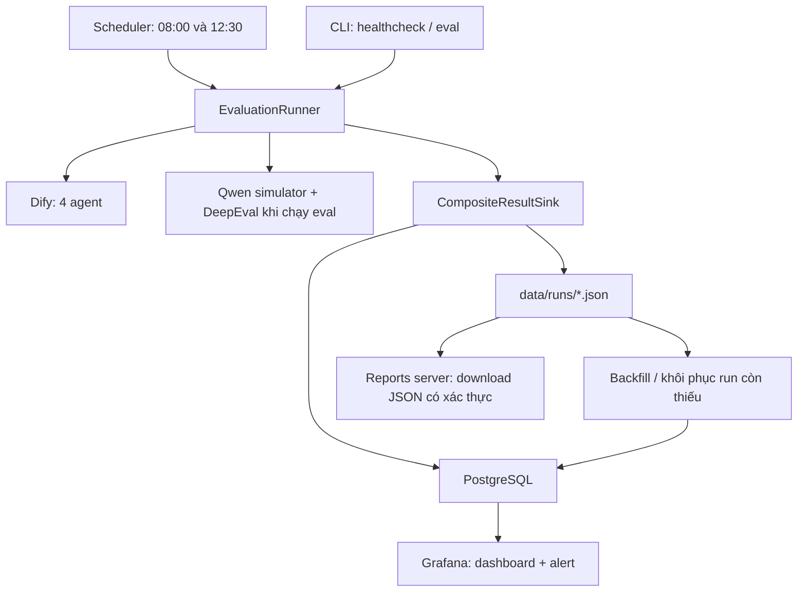

# TicketAgents — tài liệu hệ thống healthcheck và evaluation

Tài liệu này mô tả hệ thống đã triển khai với Grafana, PostgreSQL và scheduler. Bốn agent Dify được kiểm tra tự động lúc **08:00 và 12:30 mỗi ngày**, theo múi giờ **Asia/Ho_Chi_Minh**. Evaluation nhiều lượt được chạy thủ công bằng CLI.

## 1. Mục đích và phạm vi

| Agent | Nghiệp vụ |
| --- | --- |
| `leave` | Tạo và quản lý đơn nghỉ |
| `late` | Tạo và quản lý đơn đi trễ |
| `helpdesk` | Quản lý ticket IT |
| `bookroom` | Quản lý lịch và phòng họp |

Hệ thống có hai luồng:

- **Healthcheck:** gửi probe được cấu hình cho từng agent để kiểm tra phản hồi, stream và thời gian xử lý. Luồng này không dùng Qwen để chấm điểm.
- **Evaluation:** đọc test case có sẵn, dùng Qwen mô phỏng user qua nhiều lượt và làm evaluation model cho DeepEval, sau đó ghi metric, rule và verdict.

Grafana là giao diện xem kết quả và cảnh báo. Người dùng kích hoạt chạy thủ công bằng CLI; scheduler phụ trách lịch tự động. Streamlit đã được gỡ. Module generate còn trong mã nguồn nhưng không có giao diện hoặc lệnh generate trong phạm vi hiện tại.

## 2. Kiến trúc hiện tại



Docker Compose chạy bốn service:

| Service | Vai trò | Truy cập từ máy host |
| --- | --- | --- |
| `postgres` | Lưu run, metric, rule, transcript, tool trace và batch | `127.0.0.1:5433` |
| `scheduler` | Chạy lịch healthcheck, tạo schema và nhập lại JSON còn thiếu | Không mở port |
| `grafana` | Dashboard và cảnh báo | http://localhost:3000 |
| `reports` | Tải JSON gốc theo run ID, có Basic Auth | http://localhost:8081 |

Các port chỉ bind localhost. Grafana dùng tài khoản PostgreSQL `grafanareader` có quyền SELECT; runner dùng tài khoản ghi `ticketagents`.

## 3. Chạy app trên máy đã cấu hình

Mở Docker Desktop và đợi Docker Engine sẵn sàng. Trong PowerShell:

```powershell
cd D:\HocTap\Intern\Healthcheck4Bot\TicketAgents
docker compose --env-file observability/.env -f observability/docker-compose.yml up -d
```

Mở http://localhost:3000:

1. Đăng nhập bằng user `admin`.
2. Lấy mật khẩu từ `GRAFANA_ADMIN_PASSWORD` trong `observability/.env`.
3. Vào **Dashboards → TicketAgents → Agent Health Overview**.

Dashboard đọc lại dữ liệu mỗi 30 giây. Nút refresh Grafana chỉ cập nhật dữ liệu đang lưu; để thực hiện probe mới, chạy lệnh healthcheck hoặc chờ lịch scheduler.

Kiểm tra service và xem log:

```powershell
docker compose --env-file observability/.env -f observability/docker-compose.yml ps
docker compose --env-file observability/.env -f observability/docker-compose.yml logs --tail 100 scheduler
docker compose --env-file observability/.env -f observability/docker-compose.yml logs --tail 100 grafana
```

Sau khi sửa code hoặc requirements:

```powershell
docker compose --env-file observability/.env -f observability/docker-compose.yml up -d --build
```

Tất cả lệnh Compose bên dưới được chạy từ thư mục `TicketAgents`.

## 4. Cài đặt lần đầu

Cần Docker Desktop chạy Linux containers và kết nối được tới Dify. Qwen cần thiết khi chạy evaluation.

Chỉ tạo file cấu hình nếu chưa tồn tại:

```powershell
if (-not (Test-Path .env)) {
    Copy-Item .env.example .env
}
if (-not (Test-Path observability/.env)) {
    Copy-Item observability/.env.example observability/.env
}
```

Điền thông tin kết nối trong `.env`:

- `DIFY_BASE_URL` và API key tương ứng bốn agent.
- `QWEN_BASE_URL`, `QWEN_BEARER`, `QWEN_MODEL` cho evaluation.
- `HEALTHCHECK_SLOW_SECONDS`: ngưỡng phân loại Slow, tính bằng giây.

Trong `observability/.env`, đặt các mật khẩu riêng cho `POSTGRES_PASSWORD`, `GRAFANA_READER_PASSWORD`, `GRAFANA_ADMIN_PASSWORD` và `REPORT_PASSWORD`. Sau đó chạy:

```powershell
docker compose --env-file observability/.env -f observability/docker-compose.yml up -d --build
```

Scheduler tự tạo/cập nhật schema PostgreSQL khi khởi động. Khi chạy container, Compose tự cấp thông tin kết nối DB. `.env` là file credentials ứng dụng; `observability/.env` cung cấp mật khẩu stack và các biến lịch chạy được Compose truyền vào scheduler.

Nếu Dify/Qwen chạy trên máy host, địa chỉ `localhost` trong container trỏ về chính container; sử dụng địa chỉ host phù hợp, chẳng hạn `host.docker.internal` trên Docker Desktop.

## 5. Healthcheck tự động

Cấu hình mặc định trong `observability/.env`:

```dotenv
ENVIRONMENT=staging
HEALTHCHECK_SCHEDULES=08:00,12:30
HEALTHCHECK_TIMEZONE=Asia/Ho_Chi_Minh
HEALTHCHECK_AGENTS=leave,late,helpdesk,bookroom
HEALTHCHECK_WEEKDAYS=mon-sun
HEALTHCHECK_MISFIRE_GRACE_MINUTES=15
```

Lịch áp dụng mọi ngày, kể cả cuối tuần. Đổi `HEALTHCHECK_WEEKDAYS=mon-fri` để chỉ chạy thứ Hai đến thứ Sáu. Sau khi sửa cấu hình, áp dụng lại:

```powershell
docker compose --env-file observability/.env -f observability/docker-compose.yml up -d
```

Máy và Docker Desktop cần hoạt động vào giờ chạy; scheduler không đánh thức máy đang tắt hoặc sleep.

Scheduler kiểm tra các mốc đến hạn mỗi 15 giây. Nếu khởi động lại trong vòng 15 phút sau mốc lịch, scheduler có thể chạy mốc gần nhất chưa được claim. Qua thời hạn này, mốc bị bỏ lỡ được thể hiện trên dashboard và rule cảnh báo. Nếu có nhiều mốc cùng nằm trong khoảng chạy bù, chỉ xét mốc gần nhất.

Mỗi mốc lịch tạo một `batch_id` với `environment`, `scheduled_for` và danh sách agent dự kiến. Unique constraint trên `environment + scheduled_for` chống chạy trùng qua restart. PostgreSQL advisory lock ngăn hai batch của cùng môi trường chạy chồng.

Các agent chạy tuần tự. Lỗi của một agent vẫn cho phép kiểm tra các agent tiếp theo. Batch `completed` nghĩa là vòng chạy đã lưu được kết quả cho đủ agent; từng agent vẫn có thể `Error`. Cần xem thêm số kết quả trong DB và số agent lỗi ở `batch_progress`.

Nếu process crash sau khi claim, batch có thể giữ trạng thái `running`. Scheduler không tự chạy lại slot đã claim; dashboard và cảnh báo thể hiện batch chưa hoàn thành. PostgreSQL phải sẵn sàng để scheduler claim một batch mới.

## 6. Chạy healthcheck và evaluation thủ công

Chạy ngay cả bốn agent:

```powershell
docker compose --env-file observability/.env -f observability/docker-compose.yml exec scheduler python run.py healthcheck --agent all
```

Chạy riêng một agent:

```powershell
docker compose --env-file observability/.env -f observability/docker-compose.yml exec scheduler python run.py healthcheck --agent leave
```

Chạy evaluation với case có sẵn:

```powershell
docker compose --env-file observability/.env -f observability/docker-compose.yml exec scheduler python run.py eval --agent leave --cases data/seeds/leave.yaml
```

Thêm `--case-id <id>` để chọn một case; có thể lặp lại tham số này. Case nằm trong file YAML/JSON và được kiểm tra bằng Pydantic. Runner gửi `initial_message`, giữ conversation ID và dùng Qwen sinh các lượt user tiếp theo theo `intent` và `follow_up_behavior`, trong giới hạn số lượt.

Lệnh healthcheck/eval thủ công có `trigger=manual`, không thay thế batch 08:00 hoặc 12:30. Evaluation hiện không chạy tự động theo hai mốc này.

Nếu chạy trực tiếp bằng Python trên host:

```powershell
..\.venv\Scripts\python.exe -m pip install -r requirements.txt
..\.venv\Scripts\python.exe run.py db-init
..\.venv\Scripts\python.exe run.py healthcheck --agent all
..\.venv\Scripts\python.exe run.py eval --agent leave --cases data/seeds/leave.yaml
```

Các lệnh trên giả định virtualenv ở thư mục cha như workspace hiện tại. Cấu hình `DATABASE_URL=postgresql://ticketagents:<password>@127.0.0.1:5433/ticketagents` trong `.env` với password trùng `POSTGRES_PASSWORD`. Muốn chỉ lưu JSON, đặt `RESULT_SINK=json`.

Lệnh `python run.py scheduler` chạy scheduler liên tục; `python run.py scheduler --once` chỉ xét lịch đến hạn và khôi phục JSON một lần, không ép chạy một mốc chưa đến giờ. Chạy một scheduler của cùng môi trường với cấu hình thống nhất.

## 7. Ý nghĩa trạng thái và dữ liệu đo

Healthcheck phân loại theo logic hiện tại:

| Trạng thái | Điều kiện |
| --- | --- |
| `Error` | Request lỗi, stream chưa hoàn tất hoặc câu trả lời rỗng |
| `Slow` | Không có lỗi trên và tổng thời gian vượt `HEALTHCHECK_SLOW_SECONDS` |
| `Healthy` | Phản hồi hợp lệ theo kiểm tra trên và không vượt ngưỡng |

`Healthy` không chứng minh câu trả lời đúng nghiệp vụ. Muốn kiểm tra độ đúng, dùng evaluation.

Trace bao gồm thời gian tới event đầu tiên, TTFT (thời gian tới token trả lời đầu tiên), tổng thời gian, trạng thái `stream_complete` và danh sách tool call. Tool duration chỉ được ghi khi trace có dữ liệu timing phù hợp; trường không đo được giữ `null` với `timing_source=unavailable`.

Evaluation lưu `PASS`, `FAIL` hoặc `ERROR` trong `evaluation.verdict`. Metric có thể `completed`, `skipped` hoặc `error`. `skipped` là thiếu đầu vào cần thiết, không được tính thành điểm 0.

Các metric cơ bản là Turn Relevancy, Role Adherence, Knowledge Retention, Conversation Completeness, Goal Accuracy và Topic Adherence. Tool Use chỉ chạy khi có tool trace. Faithfulness và contextual metrics chỉ chạy khi có retrieval context. Threshold mặc định trong evaluator hiện tại là **0.3**.

Các rule hiện có kiểm tra số lượt user tối thiểu, stream completion, lộ identifier/tên tool và tuyên bố thành công khi không có tool success. Các yêu cầu nghiệp vụ chi tiết trong case không đồng nghĩa đã có rule deterministic riêng cho từng yêu cầu.

Metric lỗi dẫn tới verdict `ERROR`; metric không đạt hoặc rule critical thất bại dẫn tới `FAIL`; còn lại là `PASS`. Average score chỉ lấy các metric đã hoàn tất có điểm, dùng để quan sát, không thay thế verdict.

## 8. Dashboard Grafana

### Agent Health Overview

Hiển thị bốn card trạng thái gần nhất, thời điểm kiểm tra, TTFT, total latency, lịch sử Healthy/Slow/Error, P50/P95, tỷ lệ stream hoàn tất, kết quả các batch trong ngày và tool calls. Card thể hiện kết quả gần nhất đã lưu; cần đối chiếu timestamp và bảng batch để nhận biết dữ liệu cũ hoặc lịch bị lỡ.

### Evaluation Quality

Hiển thị số PASS/FAIL/ERROR, pass rate theo agent, score theo thời gian, runtime, metric skipped/error và các rule thất bại. Bảng run cho phép mở chi tiết bằng `run_id`.

### Run Detail

Hiển thị thông tin run, transcript, score/threshold/reason của metric, rule, tool trace và link JSON gốc. Nội dung transcript trong DB mặc định là placeholder vì `DATABASE_STORE_TRANSCRIPT=false`.

Link download cần đăng nhập riêng bằng user `reports`, password `REPORT_PASSWORD` trong `observability/.env`. File tải là JSON gốc, có thể chứa payload nghiệp vụ và dữ liệu cá nhân.

Dashboard, datasource và alert được provision từ file trong `observability/grafana/`. Sửa file nguồn khi cần giữ thay đổi qua các lần triển khai. URL download hiện trỏ tới localhost; cần chỉnh lại nếu triển khai cho máy khác truy cập.

## 9. Cảnh báo

Grafana đánh giá năm rule mỗi phút, với khoảng pending một phút:

| Rule | Điều kiện |
| --- | --- |
| Scheduled batch missing or incomplete | Mốc lịch trong ngày đã quá grace nhưng batch chưa có, chưa kết thúc, thiếu kết quả DB hoặc không completed |
| Latest healthcheck is Error | Healthcheck mới nhất của agent trong 24 giờ có trạng thái Error |
| Two consecutive slow healthchecks | Hai healthcheck gần nhất trong 7 ngày đều Slow |
| Evaluation ERROR in last 24 hours | Có evaluation ERROR trong 24 giờ |
| Evaluation pass rate below 80 percent | Pass rate trong 7 ngày dưới 80%, với ít nhất 5 run |

Với lịch mặc định, rule batch bắt đầu thỏa điều kiện sau 08:15 hoặc 12:45; còn phụ thuộc chu kỳ đánh giá và pending nên không bảo đảm phát cảnh báo đúng từng phút đó. Rule batch xét tất cả agent của lịch, kể cả khi dashboard đang lọc một agent.

Ngày đầu triển khai sau giờ lịch có thể xuất hiện cảnh báo các mốc trước lúc cài đặt. Một batch hoàn tất có agent Error sẽ được phản ánh qua số agent lỗi và rule healthcheck Error.

Cảnh báo hiển thị trong **Alerting → Alert rules**. Muốn nhận email/webhook cần cấu hình contact point và notification policy; hệ thống chưa cấu hình sẵn người nhận bên ngoài.

## 10. Lưu trữ và khôi phục

Runner ghi JSON nguyên tử trước khi ghi PostgreSQL. Nếu ghi DB thất bại, JSON vẫn được giữ và có log báo lỗi. Nếu ghi JSON thất bại, không coi kết quả là đã được lưu thành công.

Scheduler nhập lại các run còn thiếu trong DB lúc khởi động và mỗi 5 phút. Muốn nhập lại toàn bộ file, kể cả cập nhật run đã tồn tại:

```powershell
docker compose --env-file observability/.env -f observability/docker-compose.yml exec scheduler python run.py backfill --runs-dir data/runs
```

Backfill dùng transaction và upsert theo `run_id`, chạy lại không tạo bản ghi trùng. Run cũ thiếu environment được gán environment của cấu hình đang dùng. Import JSON thủ công không tạo lại scheduled batch nếu file gốc không có thông tin lịch tương ứng.

Schema hiện tại:

| Bảng / view | Nội dung |
| --- | --- |
| `runs` | Cả healthcheck và evaluation: agent, trigger, thời gian, trạng thái, score, lỗi và thông tin timing |
| `metric_results`, `rule_results` | Kết quả chấm từng metric và rule |
| `tool_calls` | Tool theo từng turn, trạng thái và timing; không lưu input/output |
| `transcript_turns` | Role, nội dung đã xử lý hoặc placeholder, latency |
| `scheduled_batches` | Slot đã claim, danh sách agent dự kiến và trạng thái vòng chạy |
| `schedule_settings` | Timezone, slot, ngày chạy, agent và grace theo environment |
| `batch_progress` | Tổng hợp số agent đã có kết quả DB và số agent Error |
| `expected_batches` | Sinh các mốc dự kiến từ cấu hình để nhận biết lịch bị lỡ |

Không có bảng healthchecks hoặc run_errors riêng; dữ liệu tương ứng nằm trong `runs`.

## 11. Dữ liệu nhạy cảm và vận hành

DB không lưu raw SSE hoặc tool input/output. `DATABASE_STORE_TRANSCRIPT=false` là mặc định. Khi bật `true`, nội dung transcript được redaction trước khi lưu DB; đặt `DATABASE_REDACT_TRANSCRIPT=false` để lưu transcript nguyên văn. Metric reason và error vẫn qua redaction. Cơ chế redaction mask credential, email, UUID, một số identifier, dãy số dài và các tên/ID trong configured inputs, nhưng không nhận diện toàn bộ dữ liệu cá nhân.

Sau khi đổi chế độ lưu transcript, chạy backfill thủ công nếu muốn cập nhật các run đã có trong DB. JSON gốc không qua cùng bước redaction và vẫn nằm ở `data/runs`; dịch vụ reports chỉ phục vụ người có tài khoản download.

`.env` không được copy vào Docker image. Không đưa credentials và JSON nghiệp vụ lên Git. Với triển khai ngoài máy local, cần cấu hình địa chỉ truy cập, TLS và quyền truy cập phù hợp.

PostgreSQL và Grafana dùng named volumes, JSON được bind-mount từ `data/runs`. Dừng stack và giữ dữ liệu:

```powershell
docker compose --env-file observability/.env -f observability/docker-compose.yml down
```

Không thêm `-v` khi muốn giữ lịch sử. Sao lưu PostgreSQL và JSON riêng; volume không thay thế backup.

Mật khẩu PostgreSQL/reader và tài khoản admin Grafana được khởi tạo trong dữ liệu lưu trữ. Khi volume đã tồn tại, đổi biến mật khẩu không tự cập nhật toàn bộ tài khoản; cần đổi mật khẩu tương ứng trong DB/Grafana và đồng bộ cấu hình.

## 12. Cấu trúc mã nguồn

```text
TicketAgents/
├── run.py                       # CLI: healthcheck, eval, scheduler, db-init, backfill
├── Dockerfile
├── configs/agents.yaml           # Agent, probe, inputs và tool definitions
├── eval_tool/
│   ├── runner.py                # Thực thi healthcheck/evaluation
│   ├── scheduler.py             # Lịch, claim batch, khóa và phục hồi JSON
│   ├── dify_client.py           # Streaming response và trace
│   ├── user_simulator.py        # Qwen mô phỏng user
│   ├── evaluator.py             # DeepEval và rules
│   ├── models.py                # Pydantic schemas
│   ├── result_sink.py           # ResultSink, JsonResultSink, CompositeResultSink
│   ├── postgres_sink.py         # Ghi dữ liệu chuẩn hóa vào DB
│   ├── report.py                # Tên file kết quả JSON
│   ├── report_server.py         # Download JSON có xác thực
│   ├── db.py                   # Kết nối và migration
│   ├── backfill.py              # Import JSON vào DB
│   └── redaction.py             # Xử lý nội dung nhạy cảm trước khi ghi DB
├── migrations/001_initial.sql
├── observability/
│   ├── docker-compose.yml
│   ├── .env.example
│   ├── postgres/init-reader.sh
│   └── grafana/
│       ├── dashboards/         # 3 dashboard JSON
│       └── provisioning/       # Datasource, dashboard provider, alert rules
├── scripts/verify_monitoring.py
├── data/
│   ├── seeds/
│   └── runs/
└── tests/
```

## 13. Kiểm thử và chẩn đoán

Chạy unit tests bằng Python trên host có cài pytest:

```powershell
..\.venv\Scripts\python.exe -m pytest tests -q
```

Chạy cả integration tests với PostgreSQL trong stack:

```powershell
docker compose --env-file observability/.env -f observability/docker-compose.yml exec -T -e TEST_DATABASE_URL=dbname=ticketagents scheduler python -m pytest tests -q
```

Integration tests tạo và xóa schema riêng `monitoring_test_<uuid>` để kiểm tra ghi DB, backfill idempotent, chống trùng slot, chống chạy chồng và batch lỗi một phần.

Xác minh dashboard SQL, alert health, quyền read-only và xác thực download trên stack local:

```powershell
..\.venv\Scripts\python.exe scripts/verify_monitoring.py
```

Script smoke test này cần `DATABASE_URL` của host và `observability/.env`; cấu hình kiểm tra hiện dùng environment `staging` và dữ liệu run sẵn có. Script không gọi Dify/Qwen.

Khi có lỗi:

- Không mở được Grafana: kiểm tra Docker Desktop, `compose ps` và log Grafana/scheduler. Grafana đợi scheduler healthy khi khởi động bằng Compose.
- Không có kết quả mới: xem log scheduler, timestamp gần nhất, cấu hình timezone và grace; refresh Grafana không thực thi healthcheck.
- JSON đã có nhưng DB thiếu: xem lỗi database và chạy backfill.
- Tool duration hoặc một số metric bị thiếu: kiểm tra trace/retrieval context từ Dify; không tự thay giá trị thiếu bằng 0.
- Lệnh evaluation lỗi: kiểm tra kết nối Qwen, cấu hình model và case; probe healthcheck có thể vẫn Healthy khi evaluation lỗi.

Hướng dẫn khởi động nhanh cũng có trong [README](../README.md).
